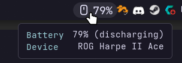
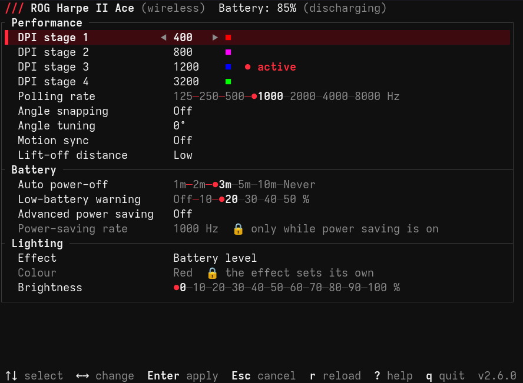

# rogctl

Battery levels for ASUS mice and keyboards on Linux, a settings screen for the mice, and panel
widgets for Noctalia, Waybar, Quickshell, DankMaterialShell, KDE Plasma and GNOME.

It supports 27 battery-powered ROG, TUF and ASUS mice and 8 ROG keyboards, on their own
receiver, a USB cable, or the ROG SpeedNova 8K and ROG Omni receivers. See
[Supported mice](#supported-mice) and [Supported keyboards](#supported-keyboards).

<table align="center">
  <tr>
    <td align="center" valign="middle">
      
    </td>
    <td align="center" valign="middle">
      
    </td>
  </tr>
  <tr>
    <td align="center">Panel widget</td>
    <td align="center"><code>rogctl settings</code></td>
  </tr>
</table>

## Getting started

1. **Check your mouse or keyboard is supported.** Find it in [Supported mice](#supported-mice)
   or [Supported keyboards](#supported-keyboards).

2. **Install rogctl.** On Arch Linux, install it from the AUR, which includes the udev rule
   (skip step 3, then replug the mouse or keyboard):

   ```sh
   paru -S rogctl        # or: yay -S rogctl
   ```

   Elsewhere, build it with a Rust toolchain (`cargo`; most distributions package it as `rust`
   or `rustup`). This puts `rogctl` in `~/.cargo/bin`, which needs to be on your `PATH`.

   ```sh
   git clone https://github.com/humblemonk/rogctl.git
   cd rogctl
   cargo install --path .
   ```

3. **Allow access to the mouse and keyboard without root.** Skip this if you installed from the AUR. This
   installs a udev rule for the supported USB IDs. It opens only the one interface rogctl
   uses on each device:

   ```sh
   sudo cp udev/70-rogctl.rules /etc/udev/rules.d/
   sudo udevadm control --reload && sudo udevadm trigger
   ```

4. **Read the battery.**

   ```sh
   rogctl
   ```

   You should see the mouse's name and level, such as `ROG Chakram X: 80%`. With no mouse
   plugged in, it shows the keyboard's. `rogctl --device all` shows every mouse and keyboard.

5. **Optional: add a panel widget.** See [Panel widgets](#panel-widgets).

Upgrading? [What changed in each release](docs/CHANGELOG.md) lists new features and fixes,
and says when a release needs you to do something after upgrading.

## Changing settings

```sh
rogctl settings
```

This shows the mouse's settings and lets you change them: DPI stages, polling rate, button
debounce, angle snapping, motion sync, lift-off distance, auto power-off, low-battery
warning, on ROG Harpe II models advanced power saving, and lighting (effect, colour and
brightness; all zones together on mice with several). It only shows the settings your mouse
has.

| Key | Does |
| --- | --- |
| ↑ ↓ | Select a setting |
| ← → | Change the value (Shift for bigger steps), or type a DPI |
| Enter | Apply the change |
| Esc | Cancel the change |
| ? | All keys |
| q | Quit |

You can also click and scroll. Nothing is sent until you press Enter (or click a selected
setting). Applied changes are saved on the mouse, so they stay after unplugging it and apply
on other computers too. Changing the lift-off distance also resets the sensor calibration.

Want to look first? `rogctl settings --demo` shows the screen without a mouse and changes
nothing.

To change settings from a script or a keybinding instead, use `rogctl settings set`, such as
`rogctl settings set polling-rate=1000 dpi-2=1600`; `rogctl settings get` lists the settings
and their names. `rogctl settings export FILE` saves them all to a file, and
`rogctl settings import FILE` puts them back, on the same model, changing only what differs.
See [the command reference](docs/cli.md#settings-from-the-command-line).

The settings screen needs a terminal of at least 80×24. In a smaller one it shows the size it
needs, and only `q` and `Ctrl+C` work.

## Panel widgets

Each widget shows the battery level of your mouse and keyboard in your panel or bar, an icon
and level for each; its **Show** setting picks one of them instead. It turns red when a
battery is low (20% by default), dims a device while it sleeps and hides while nothing is
plugged in. All but Waybar also send a notification when a battery gets low. In Waybar, the
mouse and the keyboard are a module each.

Install the one for your desktop with `rogctl configure`, such as:

```sh
rogctl configure kde
```

| Desktop | Command | Details |
| --- | --- | --- |
| Noctalia | `rogctl configure noctalia` | [noctalia/](noctalia/README.md) |
| Waybar (Hyprland, Sway, niri, …) | `rogctl configure waybar` | [waybar/](waybar/README.md) |
| Quickshell config of your own | `rogctl configure quickshell` | [quickshell/](quickshell/README.md) |
| DankMaterialShell | `rogctl configure dms` | [dms/](dms/README.md) |
| KDE Plasma 6 | `rogctl configure kde` | [kde/](kde/README.md) |
| GNOME 45 or newer | `rogctl configure gnome` | [gnome/](gnome/README.md) |

It prints the step left to do by hand, such as adding the widget to your panel. Run it again
after updating rogctl to update the widget, or add `--remove` to remove it. Waybar's config is
yours, so for Waybar it prints the module to add rather than editing the config.

If a widget says rogctl wasn't found, your desktop's `PATH` probably doesn't include
`~/.cargo/bin`. Set the widget's **rogctl command** setting to the full path, such as
`/home/you/.cargo/bin/rogctl`.

## Troubleshooting

- **`No supported mouse or keyboard found`**: the receiver or cable isn't plugged in, or the
  device isn't in [Supported mice](#supported-mice) or
  [Supported keyboards](#supported-keyboards). `rogctl list` shows what was detected.
- **`Permission denied`**: the udev rule from step 3 isn't active yet. Unplug and replug the
  receiver or cable, or log out and back in. For a keyboard on its own receiver or cable, a
  rule from before rogctl 2.7.0 doesn't cover it: install the rule again.
- **`asleep or out of range`**: the mouse or keyboard is off, asleep or too far from the
  receiver. Move or type to wake it and try again.
- **Dull colours in `rogctl settings`**: without `COLORTERM=truecolor` in its environment
  (often missing over SSH), rogctl uses the 256 standard colours. If your terminal has 24-bit
  colour, set `COLORTERM=truecolor`. `NO_COLOR` turns colour off.

Something else wrong, or a setting that reads or changes wrong?
[Report it](CONTRIBUTING.md#reporting-a-problem).

## Supported mice

Only the ROG Harpe II Ace (on the SpeedNova 8K receiver) has been tested so far. The others
should work; please [report](CONTRIBUTING.md#reporting-a-problem) whether yours does. Mice not
listed here aren't detected.

<details>
<summary>All 27 mice</summary>

- ROG Chakram
- ROG Chakram X
- Gladius II Wireless
- ROG Gladius III Aimpoint
- ROG Gladius III Eva 2
- ROG Gladius III Wireless
- ROG Harpe Ace Aim Lab Edition
- ROG Harpe Ace Extreme
- Harpe Ace Mini
- ROG Harpe II Ace
- Harpe II Extreme Edition 20
- ROG Keris EVA Edition
- ROG Keris II Ace
- ROG Keris II Origin
- ROG Keris II Origin KJP
- ROG Keris Wireless
- ROG Keris Wireless Aimpoint
- ASUS Mouse MD200
- ROG Pugio II
- ROG Spatha X
- ROG Strix Carry
- ROG Strix Impact II Wireless
- Strix Impact III Wireless
- TUF GAMING M4 Wireless
- TUF GAMING Mini Miku Edition
- TX GAMING MOUSE
- TX GAMING MOUSE Mini

</details>

## Supported keyboards

rogctl shows the battery level of these keyboards; it doesn't change their settings. Only the
ROG Falchion RX Low Profile (on its Omni receiver and its cable) has been tested so far.
Keyboards not listed here aren't detected.

- ROG Azoth
- ROG Azoth Extreme
- ROG Azoth Extreme SE
- ROG Azoth X
- ROG Falchion
- ROG Falchion RX Low Profile
- ROG Strix Scope II 96
- ROG Strix Scope II 96 RX

## Scripting

`rogctl --json` and `rogctl watch --json` print the status as JSON for your own scripts and
bars. See [docs/cli.md](docs/cli.md) for every command, option, field and exit code.

## License

Everything in this repository is licensed under the GNU Affero General Public License v3.0 or
later (`AGPL-3.0-or-later`). See [LICENSE](LICENSE).
